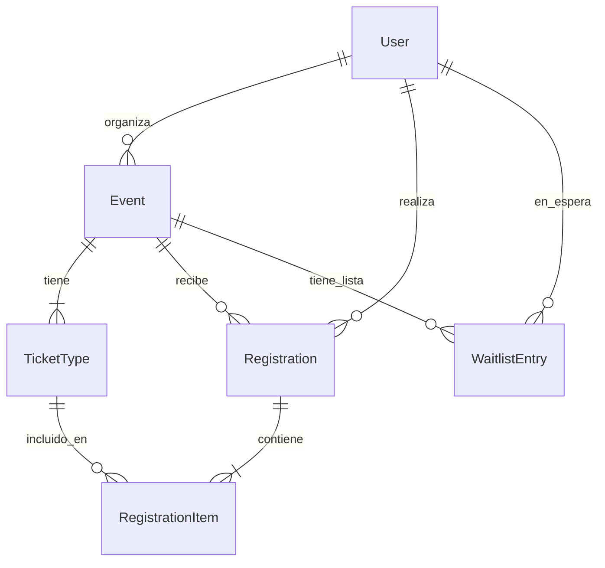

# Database

## ERD



## Entities

### 1. User
- `id` (PK), `name`, `email` (unique), `password` (bcrypt), `avatarUrl`, `bio`
- `@OneToMany` → Event, Registration, WaitlistEntry

### 2. Event
- `id` (PK), `title`, `slug` (unique), `description`, `date`, `endDate`, `location`, `category`, `imageUrl`, `capacity`, `status` (active/draft/cancelled/completed)
- `@ManyToOne` → User (organizer)
- `@OneToMany` → TicketType, Registration, WaitlistEntry

### 3. TicketType
- `id` (PK), `name`, `description`, `price`, `capacity`, `perOrderLimit`
- `@ManyToOne` → Event
- `@OneToMany` → RegistrationItem

### 4. Registration
- `id` (PK), `status` (confirmed/cancelled), `totalPrice`, `cancelledAt`
- `@ManyToOne` → User, Event
- `@OneToMany` → RegistrationItem

### 5. RegistrationItem
- `id` (PK), `quantity`, `unitPrice` (snapshot)
- `@ManyToOne` → Registration, TicketType

### 6. WaitlistEntry
- `id` (PK), `position`, `status` (waiting/promoted/expired/left), `promotedAt`
- `@ManyToOne` → User, Event

## Migration Strategy

- **Development:** SQLite via better-sqlite3 with `synchronize: true`
- **Production:** Neon/PostgreSQL with TypeORM migrations
- Schema is PostgreSQL-compatible (uses `real` for decimals, `text` for flexible strings)

## Key Queries

### Capacity Check (atomic)
```typescript
const confirmedCount = await queryRunner.manager.count(Registration, {
  where: { eventId, status: 'confirmed' },
});
if (totalQuantity > event.capacity - confirmedCount) {
  throw new ConflictException('Not enough capacity');
}
```

### Waitlist Auto-Promotion
```typescript
const nextWaitlist = await queryRunner.manager.findOne(WaitlistEntry, {
  where: { eventId, status: 'waiting' },
  order: { position: 'ASC' },
});
```

### Dashboard Aggregation
```typescript
const myEvents = await eventRepo.find({
  where: { userId },
  relations: { registrations: true, ticketTypes: true },
});
```
